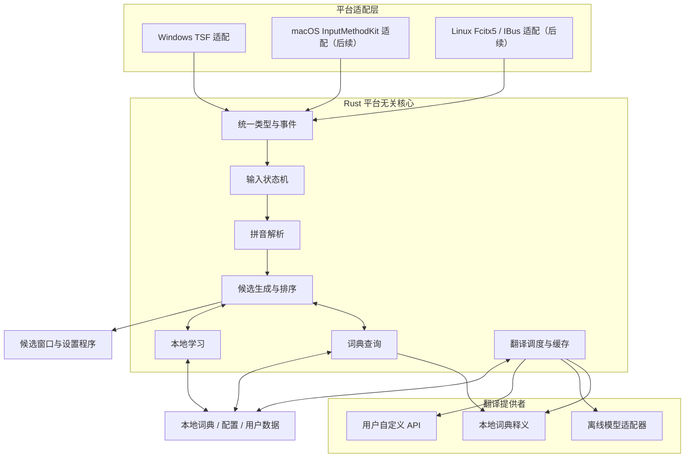

# 云笺（Cloudleaf）输入法：总体架构

- 文档路径：`docs/architecture.md`
- 文档版本：2.0，2026-10-22
- 状态：开发基线，具体实现可经设计评审后修订
- 首发平台：Windows 10/11
- 目标平台：Windows、macOS、Linux
- 核心语言：Rust
- 辅助工具：Python

## 1. 项目目标

云笺是一款独立开发的正式开源桌面输入法，目标覆盖高质量拼音与整句候选、纠错/方案扩展、本地学习/用户词典、词语/短语及整句中英互译、完整Windows系统交互和后续macOS/Linux适配。完整需求见 [product-scope.md](product-scope.md)，实施依赖见 [v2路线图](roadmap.md)。基础输入必须在本地完成，翻译服务故障不得阻止输入。

M1/M2仅为历史工程与原型基线。后续Windows、核心算法、正式数据按契约并行建设；正式产品算法不以现有64条词典、整词查询及简单排序为上限。算法/实验、宿主身份与提交三态见 [algorithm-design.md](algorithm-design.md)、[algorithm-evaluation.md](algorithm-evaluation.md)及[core-platform-contract.md](core-platform-contract.md)。

项目核心引擎由云笺团队独立设计、编码、测试和维护。不得复制青简、水杉或其他输入法项目的核心源代码、专属 UI 资源、内部数据结构或受保护的具体实现。可以遵循公开操作系统接口、公开标准和通用算法原理，并使用经过许可证审查的基础库。

## 2. 设计原则

1. **输入优先**：按键处理、拼音解析、候选生成和上屏不等待网络或重型模型。
2. **核心自研**：输入状态机、拼音解析、候选生成与排序、学习策略、词典查询和翻译调度由本项目实现。
3. **平台解耦**：平台层只做系统事件转换、文本组合与提交、窗口呈现和平台生命周期管理。
4. **离线优先**：无网络、无 API Key、翻译服务未安装时，基础输入仍可用。
5. **可替换后端**：词典、离线模型和用户自定义在线服务通过明确接口接入。
6. **隐私默认保护**：默认不发送输入文本到远端，不记录完整输入日志，不在日志中记录密钥。
7. **可验证**：关键算法有单元测试，性能目标有可重复基准，发布前在真实应用中验收。
8. **许可证可追溯**：代码、词典、语料、模型、字体和 UI 素材分别登记来源及授权。

## 3. 系统边界

### 3.1 系统负责

- 中文拼音输入与候选选择。
- 本地词典检索、候选排序和用户词频学习。
- 候选旁的短释义展示。
- 中译英、英译中的整句翻译流程。
- 离线翻译模型适配和用户自定义 API 配置。
- 设置、日志诊断、词典升级和安装包。

### 3.2 系统暂不负责

- 自行训练大型机器翻译模型。
- 运营公共在线翻译服务或提供默认在线额度。
- 默认账号、云同步和跨设备输入历史同步。
- 在首版同时支持所有输入方案和所有操作系统。
- 用网络模型代替基础拼音输入核心。

## 4. 总体架构



图中翻译路径与实时输入路径逻辑分离。具体部署可将模型运行器或网络请求放在独立进程，但进程边界不是核心接口的替代品。

## 5. 分层职责

### 5.1 平台适配层

平台适配层负责：

- 接收操作系统按键与输入法生命周期事件。
- 将原生事件转换为云笺定义的输入事件。
- 维护操作系统要求的组合文本状态。
- 显示候选窗口并提交最终文本。
- 处理焦点变化、输入法激活/停用和应用兼容性差异。
- 向核心传递上下文变化，并消费核心返回的候选帧。

平台适配层不得实现自己的拼音解析、候选生成、候选排序、词典访问或翻译策略。若某个平台存在必须在平台层处理的系统限制，应记录原因、范围和测试，不能借此复制核心业务逻辑。

### 5.2 Rust 核心

核心至少划分为以下职责模块：

- `types`：平台无关的数据类型和错误类型。
- `config`：配置解析、默认值、版本迁移。
- `input`：输入状态与事件处理。
- `pinyin`：拼音解析、分段和纠错扩展点。
- `dictionary`：词条查询、索引与释义。
- `candidate`：候选生成、打分和稳定排序。
- `learning`：用户词频、用户词典和本地学习策略。
- `translation`：翻译任务、提供者路由、缓存和取消。
- `runtime`：后台任务生命周期、诊断和协调。

核心 crate 应尽量保持小而职责明确。模块拆分以清晰接口和可独立测试为依据，不为追求 crate 数量而创建没有实际边界的空模块。

### 5.3 翻译执行层

翻译执行层提供统一抽象，具体实现可以是：

- 本地词典和短语表。
- 离线机器翻译模型。
- 用户自建服务或用户购买的在线 API。

网络请求、模型推理和模型加载不得在同步按键回调内执行。若离线模型的内存或崩溃风险明显，应运行在独立进程中；基础输入核心不依赖翻译进程持续存活。

### 5.4 UI 与工具层

候选窗口是输入法的实时 UI，必须优先满足可读、低延迟和位置稳定。设置程序负责配置、模型管理、词典管理、隐私选项和诊断。Python 工具仅用于离线词典导入、数据清洗、质量评估、测试数据生成和许可证审计，不参与每次按键的关键路径。

设置UI技术栈在Windows方向实施时以无障碍、原生窗口需求、打包和跨平台成本完成实测决策。M1/M2没有交付设置程序；此前原生控件倾向属于设计起点，不是已验证的跨平台选型。UI不包含候选排序和翻译业务规则。

## 6. 建议仓库结构

```text
cloudleaf/
├── Cargo.toml
├── Cargo.lock
├── rust-toolchain.toml
├── README.md
├── LICENSE
├── THIRD_PARTY_NOTICES.md
├── crates/
│   ├── cloudleaf-types/
│   ├── cloudleaf-config/
│   ├── cloudleaf-input/
│   ├── cloudleaf-pinyin/
│   ├── cloudleaf-dictionary/
│   ├── cloudleaf-candidate/
│   ├── cloudleaf-learning/
│   ├── cloudleaf-translation/
│   ├── cloudleaf-runtime/
│   └── cloudleaf-testkit/
├── apps/
│   ├── windows-ime/
│   ├── settings/
│   └── translation-host/
├── adapters/
│   ├── windows/
│   ├── macos/
│   └── linux/
├── data/
│   ├── dictionaries/
│   ├── phrasebooks/
│   ├── models/
│   ├── manifests/
│   └── licenses/
├── tools/
│   ├── dictionary-import/
│   ├── corpus-cleaner/
│   ├── translation-eval/
│   ├── benchmark-data/
│   └── license-audit/
├── tests/
│   ├── integration/
│   ├── performance/
│   ├── compatibility/
│   └── fixtures/
├── docs/
│   ├── architecture.md
│   ├── input-behavior.md
│   ├── translation-api.md
│   ├── testing.md
│   └── roadmap.md
└── scripts/
```

以上为目标结构。实际初始化时可以先创建必要 crate，其余目录随对应里程碑引入。

## 7. Rust、C++ 与 Python 的边界

### Rust

负责所有平台共享的输入业务逻辑和翻译调度。核心源码不依赖任一输入法框架或平台API，在Linux CI等环境无需Windows/macOS SDK；各宿主仍需Rust目标工具链自身的系统链接库，Windows MSVC构建环境包括C++工具与Windows SDK。

### C++

不是默认核心语言。只有在 Windows 原生接口或特定系统组件使用 Rust 绑定确实无法达到可靠性要求时，才允许增加薄 C++ 桥接。桥接层不得包含拼音、候选排序、词典或翻译业务逻辑。

### Python

用于离线数据管线和质量评估。正式用户输入路径不得依赖 Python 解释器。若某个翻译后端只能通过 Python 运行，应将其作为可选独立服务，并保证服务不可用时输入法仍可正常输入。

## 8. Windows 优先策略

首发 Windows 使用 TSF 接入系统文本输入。TSF 的 COM 生命周期、文本组合、候选窗口、焦点切换和应用兼容性是平台适配工作，不应影响 Rust 核心 API。

优先评估通过 Rust COM 绑定实现薄适配层。如果在必要接口、调试或兼容性方面遇到明确障碍，可引入最薄的 C++ 桥接模块，并为边界增加集成测试。

首发不要求所有平台同时完成，但公共核心的构建与测试不得被 Windows 专属依赖锁死。macOS 后续评估 InputMethodKit，Linux 优先评估 Fcitx5，并按需求考虑 IBus。

## 9. 数据与存储

建议分离以下数据：

- 只读基础词典与短语表。
- 用户自定义词典。
- 用户词频和学习数据。
- 翻译缓存。
- 应用配置。
- 模型清单和模型文件。
- 诊断日志。

基础词典应使用带版本和校验信息的发布格式；配置、学习数据和缓存可以使用 SQLite 或其他经基准测试确认合适的本地存储。高频候选查询应使用适当索引，不能每次按键重新读取整份词典。

每份随包数据都必须记录来源、版本、许可证、署名要求和校验值。数据许可证与程序许可证分开管理。

## 10. 进程与并发模型

至少逻辑区分：

1. 实时输入线程/调用路径。
2. 低优先级词典注释补充任务。
3. 整句翻译任务。
4. 模型加载和资源管理任务。
5. 设置、日志与数据维护任务。

不要为每次按键创建一个长期存活的线程。采用有界队列、任务取消、过期结果过滤和明确的资源所有权，避免线程数量失控。

若使用独立翻译进程，进程间协议必须有版本号、消息长度限制、错误码和请求 ID。输入核心必须能处理翻译进程未启动、退出、无响应或返回无效数据的情况。

## 11. 性能基线

初始工程目标如下，必须通过真实基准验证，不得将目标描述成已经实现的性能：

- 核心输入事件处理 P95 不超过 5 ms，P99 不超过 10 ms。
- 常规本地候选查询 P95 不超过 5 ms。
- 端到端按键到候选显示单独测量，目标值在首轮原型后确定。
- 网络请求、模型加载与整句推理不阻塞输入事件。
- 翻译任务取消或过期后，不得覆盖更新的结果。
- 词典规模、候选数量、CPU、内存和构建版本必须随性能结果记录。

性能测量需区分核心计算时间、跨进程时间、平台事件处理时间和实际显示时间。

## 12. 依赖治理与许可证

新增依赖前必须审查：

- 许可证及与项目许可证的兼容性。
- 维护状态和安全更新情况。
- 是否引入不必要的运行时或后台服务。
- 二进制体积和启动影响。
- 是否会把平台专属依赖带入公共核心。

锁定依赖版本，提交 `Cargo.lock`，并在 CI 中执行格式检查、静态检查、测试和依赖审计。代码、数据、模型、字体和图标必须分别登记授权。

## 13. 关键架构决策

| 决策 | 当前基线 | 重新评估条件 |
|---|---|---|
| 核心语言 | Rust | 只有测量或平台限制提供充分证据时才调整 |
| 首发平台 | Windows | 不影响公共核心平台无关性 |
| Windows 接入 | TSF | 经原型验证选择 Rust 绑定或薄 C++ 桥接 |
| 基础输入 | 完全本地 | 不允许依赖在线服务 |
| 翻译 | 统一提供者接口 | 新后端必须通过相同接口和测试 |
| 整句翻译 | 异步任务 | 不得进入同步按键路径 |
| Python | 数据工具与评估 | 不进入实时核心调用链 |
| 核心自研 | 项目独立实现 | 第三方基础设施须单独审查 |

## 14. 完成定义

任何核心模块被视为完成，至少应满足：

- 具有明确的输入、输出和错误语义。
- 有自动化单元测试。
- 有边界情况测试。
- 通过格式与静态检查。
- 没有未经审查的第三方代码或数据。
- 若影响性能，附有基准结果。
- 若影响用户行为，同步更新相关文档。
- 没有平台专属业务逻辑泄漏到公共核心。

## 15. M1/M2 工程决策补充

2026-10-22 建立六个实际crate：types、pinyin、dictionary、candidate、input及CLI；其他模块随对应阶段引入。Rust/MSRV固定1.90.0，零第三方Rust库依赖。原型接口/日志策略见[M1/M2约定](m1-m2-design.md)，v2设计见本文件前述链接。Windows/Linux基线CI已真实通过；平台独立指源码与业务边界，不免除宿主工具链的系统链接要求。
