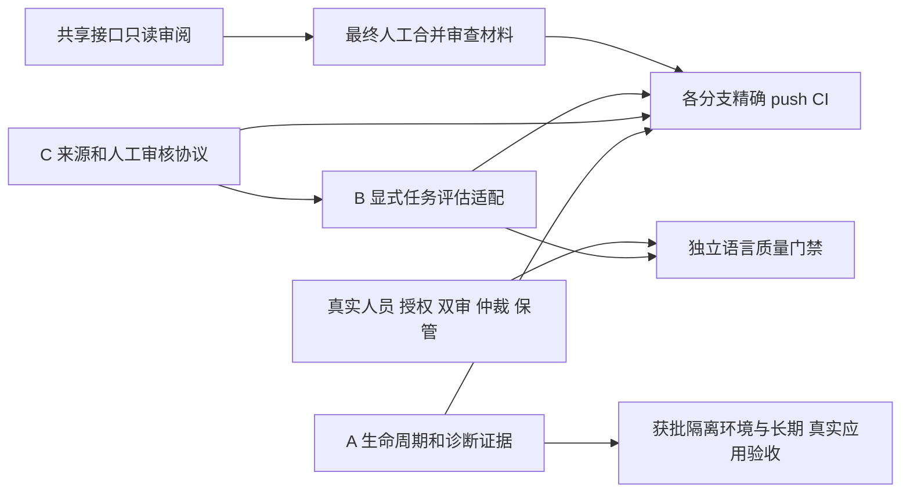

# Round 7：可靠性收敛、正式评估适配与来源审查

2026-10-29。先读取用户附件、实际AGENTS、路线/范围、Round 6报告与源码，并fetch核对本地/远程、工作区和四个开放Draft PR。保持完整产品目标；不合main、不强推、不进入CL-010，不改写Round 1–6证据。

## 实际基线

|方向|分支|完整HEAD|
|---|---|---|
|main|main|a564fd47b0f054ff360592af3ccb8d744021160f|
|共享|codex/cl007-009-contracts|c48584d411eceb82dcc6b8a30df9a33d9e995762|
|A|codex/cl007-windows|caefb7f2ac7c8584249c05359fcb174f87640886|
|B|codex/cl008-search|417dad662bfebedf3238f909476240427cc9100b|
|C|codex/cl009-data|52619a963070cd74c53d0b8d76fc40bf5b7a8327|

四工作区干净，本地/远程一致。三个方向与共享的merge-base均为`9af9bc1b2ebacc3ad76124cfa39d09de8eb77bd1`；不能把无冲突预览当实际集成。附件中的`docs/cl007-009-round6-shared/`实际位于`docs/reports/cl007-009-round6-shared/`，Windows Python测试实际位于`tests/test_windows_stress.py`，按真实文件读取，不为匹配文字另建副本。

## 遗留阻塞与本轮有界修改

|方向|Round 6遗留|本轮实际缺口/修改范围|
|---|---|---|
|A|8h/24h未执行；真实TSF/应用准入和不可回收COM/Host部署恢复未完成|生命周期七类故障矩阵、部署隔离和人工恢复边界；runner环境/执行授权预检与原始事件/周期/采样完整性。限`scripts/stress_windows_faults.py`、`tests/test_windows_stress.py`、新可靠性设计和报告/证据，不放宽预算或修改共享接口。|
|B|独立真人gold、来源语义审核、封存和完整资源门禁缺失；语言指标null|离线人工任务到评估器的显式摘要/上下文/语义分组适配；复查稳定桶端到端边界，分析R6已保存逐例样本。限方向私有评估工具/配置/测试/协议/报告，不直接替换引擎或重复无关矩阵。|
|C|现代词频、人工角色授权和正式语义未交付；研究片段不等于生产数据|已定位包级preprocessing/lineage变更仍可能沿用审核：先设计/失败测试，再修复摘要绑定；新增来源审查矩阵及完整性工具。限`annotation_workflow.py`、新`source_review.py`、测试和方向文档，不改生产导入/恢复/词库规则。|
|共享|PR #1未人工审查/合并；方向基底落后|仅审阅完整main差异、真实公开入口测试、公共接口/Unicode/错误语义、依赖与兼容性；新增`docs/reviews/pr1-round7-merge-readiness.md`和本轮证据。无共享生产代码变更计划。|

各方向先提交私有设计再测试/实现。真实未通过的断言和原文保留；没有复现缺陷不能编造红测。C/B私有适配先明确摘要语义及版本，旧审核失效要明确，不能静默兼容或发明互异共享接口。

## 依赖与执行顺序

A/B/C可并行编辑和一般回归；实际短档资源采样、算法计时和数据重型构建依次协调，不让背景负载掩盖测量边界。R6样本再分析始终绑定R6原实现/二进制/数据与本轮分析器身份，不能称新提交性能实测。算法无改时不重复整套34,560查询来增加成绩。

## 人工与真实环境要求

真人作者/双审/仲裁/heldout保管者、明确授权及答案仍未提供；任务保持pending，正式Top-1/Top-5/MRR继续null，旧正式配额和封存门禁不放宽。频率必须来自真实固定语料及分词协议，token/DF/Zipf的分母和单位分开；无值保持unknown/null。

本轮没有获批隔离Windows环境和长期执行授权；只交环境检查、短档机制证据、8h/24h固定时长计划和清单，不自动启动长测。不执行系统注册/激活/安装/卸载、真实宿主按键注入、杀Word/浏览器、跨线程强制释放COM、Unknown重放、无限预算、main合并或强推。真实环境执行与人工审查均不得用模拟宿主或CI替代。

## 验证与交付

每方向按用户指定执行fmt、Clippy `-D warnings`、locked/offline Rust单元/集成/doc、release构建、Python回归及资源许可审计；A另做Windows故障和release DLL loader，B做搜索/门禁专项，C做实际数据构建/损坏/升级回滚/中断恢复相关回归。已通过且实现未改的昂贵历史实验只核身份/原件，不改绑为本轮通过。

源码、数据、工具、二进制和报告身份分开；保存真实命令、返回码、原始UTF-8输出及失败分母。最终普通推送各自原分支，保持Draft，核对每个新HEAD的Windows/Linux push job、步骤和产物digest。方向报告分别为`docs/reports/cl007-round7-status.md`、`cl008-round7-status.md`、`cl009-round7-status.md`；共享新增Round 7汇总及PR #1审查材料。退出条件不满足继续不放行。
