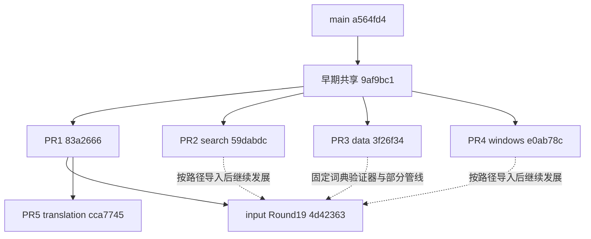

# Cloudleaf 工程整合准备审查

2026-11-16，状态 **审查完成，正式整合未执行，产品门禁未放行**。本次比较固定在Round19输入检查点，不把Round20后续源码或CI结果倒填到这次Git图。PR是否仍Draft由Round20远程API快照另行核实；下表是fetch后实际远程引用，不是凭PR标题推断。

## 固定引用与依赖

| 分支 / PR | 完整HEAD | 与输入检查点的merge-base | 输入独有 / 该方向独有提交 |
|---|---|---|---:|
| main | `a564fd47b0f054ff360592af3ccb8d744021160f` | — | — |
| input | `4d42363091361552ad525f47e3c6b1d581ae3a4c` | 本次比较端点 | — |
| #1 shared | `83a2666fa748b4ae9cba41a5880ba5353e71c9a3` | 同该HEAD | 60 / 0 |
| #2 search | `59dabdc2f8a3dc87cbd7f19ed89401ee607f7954` | `9af9bc1b2ebacc3ad76124cfa39d09de8eb77bd1` | 81 / 63 |
| #3 data | `3f26f34e00c0775124f87e150a021f99fb52c567` | `9af9bc1b2ebacc3ad76124cfa39d09de8eb77bd1` | 81 / 70 |
| #4 windows | `e0ab78c2786d652a3a19cb544b4dc83996e63264` | `9af9bc1b2ebacc3ad76124cfa39d09de8eb77bd1` | 81 / 83 |
| #5 translation | `cca77457ca3943ee5ad90d566a8d9ef6b8795cd2` | `83a2666fa748b4ae9cba41a5880ba5353e71c9a3` | 60 / 27 |

实线表示祖先关系的简化图，不表示紧邻父提交；虚线是代码来源，不是Git合并关系。输入确实包含PR1全部历史；PR2/3/4/5都不在输入祖先链中。`git cherry input branch`未发现patch完全等价提交（分别61/68/81/27个非merge独有补丁；rev-list含merge，分母不同），不能因此推断其所有功能未被导入。

输入的`6529a64d1c0bb77239e43513cb7dc5b69816bf7c`明确按路径导入搜索，`7a2242c6eaa97a4ef1c15903fcc4aa768854d0ec`导入TSF宿主和词典工具；后续输入适配、字符模型、方案与用户层在这些文件上继续开发。历史不相同、内容部分相同、功能继续扩展必须分开判断。

## 已有功能与各自边界

| 代码线 | 已有工程能力 | 仍未通过的产品条件 |
|---|---|---|
| 输入分支 | 平台无关类型/拼音/词典/候选/输入；Reference/ExactDag/PositionDag/Beam，完整词条格、Lexical/字符模型；全拼/简拼混合/小鹤、模糊/单次纠错；原文回退、revision/候选ID/提交三态；独立用户存储、共享Trie、默认关闭的Applied选择学习；TSF原生实现及隔离Host | 简拼尾延迟和剩余预算问题、独立gold、正式资源/语言质量、真实用户词库窗口完整闭环、8h/24h及真实TSF/跨应用/安装；Round20性能结果另见本轮报告 |
| PR2 | 独立搜索/评分/阶段观测、资源合同、真实词典评估工具、人工gold与lineage/泄漏门禁 | 独立gold/人员/授权与正式语言指标仍缺，不能用机械数据代替；其旧搜索src不能覆盖输入新增字符/方案/用户偏好实现 |
| PR3 | 固定来源许可/词典schema2、可复现构建、发布/升级/回滚；标注/来源家族/统计候选工具；semantic bundle reader、schema/manifest/批准失效/迁移恢复 | 正式现代频率和生产语义内容/真实审核未交付；不因导入工具将pending或research_only变production |
| PR4 | 原生COM/TSF、Host/epoch/队列/Unknown、watchdog/恢复材料、资源所有权与卸载门禁、长测runner/只读准入和报告 | 隔离VM/实际恢复/执行授权、8h/24h、异常不可回收资源后的长期可用性与真实系统应用验收仍缺；源码存在不等于可注册 |
| PR5 | 独立`cloudleaf-translation`服务、任务/取消/超时/过期过滤/有界缓存，词典查释义、显式配置在线API/SecretStore；Win32翻译面板/设置/凭据；真实Candle Marian双向CPU离线推理、SentencePiece、模型校验/导入/回退 | 独立语言质量、漏译/数字失真、生产权重分发、受控物理断网、部分安全设置人工验收；无TSF上屏和自动语言检测，模型保持research_only |

PR5的真实离线推理不能删去或降格成空接口；也不能因为它已有独立面板而宣称输入分支已经拥有翻译功能。当前输入workspace没有translation/offline/panel；翻译workspace没有search/user/windows-ime。共同input/types/pinyin等仍沿共享基线，没有现成的候选选择→翻译确认→当前输入事务桥接。

## 实际冲突与必须保留的内容

本次仅运行`git merge-tree --write-tree --messages <固定输入SHA> <方向SHA>`预览。返回1表示检测到冲突，不是实施失败；命令只创建悬空对象，未更新任何引用、索引或工作树。五次前后`show-ref`相同。预览没有编译、运行合并树，更不是集成验收。

| 方向 | 与输入均改动的路径 / 其中当前字节相同 | merge-tree冲突路径数 | 核心风险 |
|---|---:|---:|---|
| PR1 | 0 / 0 | 0 | 已为祖先；合并预览无冲突不等于人工批准 |
| PR2 | 29 / 17 | 9 | `.github/workflows/ci.yml`、`Cargo.toml`，搜索lattice/lexicon/lib/model/profiling/search及search_contract为add/add；须保留输入后续缓存绑定、来源、方案/字符/用户偏好，不选择整文件theirs |
| PR3 | 26 / 23 | 3 | `.gitattributes`、README、THIRD_PARTY_NOTICES；文本冲突少不能代表语义发布和引擎已接通 |
| PR4 | 58 / 45 | 11 | `.gitattributes`、CI、Cargo.lock、THIRD_PARTY_NOTICES、candidate/mod/render_tests/session/session_tests/windows-ime清单、依赖审计脚本；不能覆盖隔离输入/用户词库和新事务证据 |
| PR5 | 7 / 0 | 5 | `.gitattributes`、CI、Cargo.toml/lock、THIRD_PARTY_NOTICES；另有自动合并成功的README与`check_workspace.py`，必须人工复核两种审计规则是否都保留 |

固定模块比对还发现：

- PR2的三份资源/真实词典评估脚本仅在搜索方向存在：`scripts/check_search_resources.py`、`evaluate_real_lexicon.py`、`search_resource_contract.py`。搜索crate相关13个公共路径中6个字节相同、7个不同。保留独立评估工具及原失败证据，适配当前配置/Features后再运行，不用旧src替换新src。
- PR4的`ownership.rs`、`owner_cleanup.rs`、`recovery.rs`、`watchdog.rs`、`budget.rs`等公共核心文件在固定两端字节相同。`candidate/session/mod`则不同，输入新增了实际候选回调、搜索资源、隔离Host与用户层。Windows方向另有`check_windows_soak_admission.py`、`stress_windows_faults.py`、`stress_windows_owner.py`、`report_windows_soak.py`；不能将“生产模块已导入”说成长期准入工具也已完整导入。
- 对`tools/data_pipeline`、`tests`、`data/sources`、`data/licenses`所选范围，27个公共路径字节相同；PR3另有17个路径未在输入出现，包括semantic_bundle、linguistic_sidecar、source_review/source_assertions、annotation_workflow/corpus_gate/audit_isolations/ngram_analysis及相应测试。输入只导入了实际需要的pipeline/recovery等，不是整个数据方向。
- PR5的translation/offline/panel/vendor/model锁及其审计脚本所选254个路径在输入均不存在。模型权重不在Git；不得把本地约624MB原件或约312MB×2转换模型打进整合产物。
- 输入Cargo.lock为43条package记录（9个workspace、34个外部），PR5为222条（9个workspace、213个外部）。同名多版本应共存审查：PR5含windows-sys0.52.0/0.61.2、getrandom0.2.17/0.3.4/0.4.3、syn2.0.119/3.0.9；这不是要求将输入全体升级到最后一个版本。输入windows0.62.2与翻译windows-sys0.61.2是不同绑定，不能跨模块传裸HWND/COM/线程资源来省适配。
- PR5保留9个固定vendor补丁（Candle/gemm/pulp等）与`[patch.crates-io]`、原始许可、逐文件来源锁、`check_offline_vendor.py`。输入check_workspace又增加了固定词典许可验证；未来合并不能只保留其中一方policy或忽略本地源校验。现有ring版本相同也有依赖目标记录差异，须重新产生一致lock并审计，不能手工删依赖使Cargo.lock看似简洁。

具体API兼容点包括：输入`Lexicon::entries()`已从连续slice扩展为具名`Entries`共享集合，支持index/iter/len但不能假定整体排序或连续内存；`Features`增加独立`user_preference_units`，旧评估器反序列化/完整比较必须适配，不能删新字段掩盖差异；字符模型缓存绑定Lexicon实例，组合用户层须`for_user_layer`重绑并保留训练元数据；`SearchCapacityBounds`与用户构建预留、`SelectionEvidence`和两引擎发布校验不能被旧session替换。翻译使用自己的TranslationContext/TaskId/ResultVersion，不是输入revision/commit ID；当前不能互相当作确认凭据。

## 未来建议顺序与可执行退出步骤

这里只准备方案，本轮不创建集成分支、不执行以下合并。需要**额外隔离集成分支和worktree**，避免把冲突解决实验污染当前六个开发worktree或main。

1. 冻结本轮最终输入SHA、五PR SHA及CI，逐一保存已通过和未通过门禁。负责人先作PR1人工审查决定；即使批准也另行执行，Codex不代填批准或自动Ready/merge。
2. 从负责人批准的整合起点建立`codex/integration-*`及独立工作区。优先以已审输入实现作为核心来源；PR1已在其祖先链，禁止把PR2旧search和PR4旧session整文件覆盖回去。若main已前进，重新计算merge-base/预览，不复用本表冲突结果。
3. 对PR2保留差异清单中的评估/资源/人工gold工具及历史证据，按当前搜索API适配；将旧/新机械Reference完整对象差分、预算和剪枝反例全部重放。声明哪些提交按路径保留、哪些由后续实现取代，不能仅凭patch-id不同删除。
4. 对PR3补齐尚未导入的数据/semantic发布模块与测试，保留schema2已有词典reader、许可原件和unknown语义。独立sidecar先保持不影响输入；未审核语义仍pending，现代频率不推测补值。验证新旧包读取、发布原子性/损坏/回滚/中断与用户词库不被迁移覆盖。
5. 对PR4补齐长期准入runner/报告器和待授权材料，合并candidate/session的真实事务和隔离层；逐个检查所有权、STA/COM、Unknown不重放、旧epoch隔离、双引擎预检、后台队列及128MiB内部预算。仅headless/无HWND回归，不自动注册或长测。
6. 独立加入PR5三模块、审计/源补丁/模型锁及测试，合并workspace成员和CI为功能并集；重新锁定解析依赖并完整校验，不使用任一分支Cargo.lock覆盖另一分支。先保持独立exe和后台模型worker，输入消息路径不等待网络、文件或神经推理。
7. 若之后设计翻译与输入桥接，必须另先设计：词/短语/整句触发、session/revision/快照绑定、取消/失焦过滤、确认后才提交、三态回执、原文保全、用户授权与密钥隔离。翻译的Generated/ResearchOnly标签、在线逐次同意与用户词库私有边界都保留。模型整进程约1GB历史峰值与输入128MiB内部容量账本不是同一种指标，不能相加后声称同一硬限制通过。
8. 新整合精确HEAD跑两平台全workspace格式/Clippy/单元集成/doc/release、Python各方向完整测试、全部来源/许可/RustSec/vendor审计、模型工具和输入examples构建；保留三类产物：输入EXE/DLL/工具、翻译面板/离线工具、各方向性能与身份日志。普通CI不自动取得私有词库、API密钥或研究权重。
9. 按相同数据/SHA/K/预算重放输入171事件与837最终查询、用户层规模/学习与事务、无HWND Host；翻译使用既有本地授权模型回归管理/推理/取消/资源，不能将无模型单测通过当真实推理通过。实际模型质量/生产分发及人工gold继续独立门禁。
10. 整合代码审阅通过后才由负责人决定下一步；真实窗口仍user-paused，真实TSF仍需隔离环境/恢复/明确授权，8h/24h另行完整执行。新集成分支编译成功也不允许进入CL-010。

## 当前决策

不能简单依次merge五PR；也不能因输入已有较新核心就删除四个分叉PR。当前没有实际冲突解决树的编译/回归结果，依赖并集与应用交互尚未验证；正式数据、语言质量、长期和真实系统验收仍阻塞。PR1仅具备进一步人工审查条件，不表示批准合并。main不变、五PR保持Draft、无PR6；CL-010关闭。

原始命令、返回码、完整Git预览和每公共文件SHA保存在本轮`integration/commands.json`、`summary.json`、`components.json`及相邻stdout/stderr，固定SHA可重放；不是CI或产品测试通过证据。
