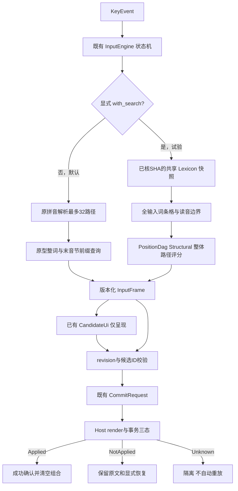

# Round 14：中文输入链路受控集成

2026-11-02，整体 **partial**。在独立`codex/input-round14`试验分支，已有搜索、真实词条和输入事务已连接，原生候选窗口可消费搜索帧。**真实大词典的自然中文排序仍明显失败**；目标长句不在前5/10，不把连通链路或模拟宿主提交叫作成熟整句输入。main不改，PR1–5保持Draft，无第六PR、TSF注册/激活/安装、8h/24h或CL-010。Round13翻译分支与成果未改动。

## 版本、工作区与整合范围

新工作区`C:\Users\EDY\.codex\worktrees\input-round14\Cloudleaf`从已核共享HEAD建立；开始时不存在同名分支/工作区，未覆盖用户修改。源方向工作区均干净，远程HEAD与给定检查点一致。

| 角色 | 固定来源 |
|---|---|
| 共享基线 | `83a2666fa748b4ae9cba41a5880ba5353e71c9a3` |
| CL-008搜索 | `59dabdc2f8a3dc87cbd7f19ed89401ee607f7954` |
| CL-009数据 | `3f26f34e00c0775124f87e150a021f99fb52c567` |
| CL-007平台 | `e0ab78c2786d652a3a19cb544b4dc83996e63264` |
| 原main | `a564fd47b0f054ff360592af3ccb8d744021160f` |
| 保留的翻译PR5 | `cca77457ca3943ee5ad90d566a8d9ef6b8795cd2` |

三方向与共享merge-base均为`9af9bc1b2ebacc3ad76124cfa39d09de8eb77bd1`，生产核心API相同但缺共享新增测试。仅按必要路径导入，不合并全部分支或覆盖共享文件；`round6_shared_review.rs`及原共享测试保留。实际Git祖先只有共享基线；方向功能的来源由逐路径Git blob/SHA登记，不伪称源提交成为本分支祖先。

设计`ca261fee25bc48cb85e7799fd2a326bce8dac270`先行；搜索原代码导入`6529a64`；缺失输入API失败测试`b14c4ff`；平台/数据工具受控导入`7a2242c`；候选空白误选失败测试`459181a`；预留容量失败测试`bbe6fac`。完整受测实现 **`a707d20ece06196edbbed3c0bf0add995c20434e`**，之后报告另作提交。

**最终完整HEAD及其自身Windows/Linux push CI写入`.local/round14-delivery-receipt.json`**，避免报告自引用SHA循环。不能用此实现SHA、其他分支或旧CI代替最终报告HEAD。只普通push独立分支，不修改现有PR正文/状态。

| 实际文件 | 目的及边界 |
|---|---|
| `crates/cloudleaf-search`全部源码/examples/既有测试，必要fixture和manifest | 复用全输入Trie词条格、Reference/ExactDag/PositionDag/Beam和阶段观测；增加装载后容量收缩，不改搜索评分 |
| `cloudleaf-input/src/sentence.rs`、`lib.rs`、`tests/search_integration.rs` | 显式试验后端、不可变词典快照、路径ID/诊断、换版本、原状态机选择/提交与原文回退 |
| `cloudleaf-types`、`cloudleaf-candidate`、CLI evaluate | 候选频率改Option；旧原型数值用Some保留，正式unknown和组合整体频率None |
| CLI参数、`input_trace` example、原创事件fixture | 运行真实核心并保留候选/路径/选择/提交与耗时，不另写输入算法或GUI |
| `adapters/windows`、`apps/windows-ime` | 原有完整COM/候选/FIFO/watchdog/recovery代码保留；双引擎注入、实际恢复成本、命中修复和原生整合回归 |
| C的9个离线工具模块、4份旧测试、固定来源锁/许可/登记 | 完整九文件包预检及现有恢复/索引回归；不引入语义、翻译或新统计数据 |
| `scripts/verify_input_lexicon.py` | 核固定既有包及范围后输出只读加载凭据；非签名、不批准新数据、不下载 |
| 依赖政策/许可/审计、Cargo/CI/README/本轮文档 | 固定34包/73份许可、Windows/Linux验证、试验工具包；不包含大词典或个人设置 |

[完整修改文件](input-round14-evidence/changed-files.tsv)、[B来源](input-round14-imports/cl008.json)、[A来源](input-round14-imports/cl007.json)、[C来源](input-round14-imports/cl009.json)及[原始证据索引](input-round14-evidence/index.json)。文件清单截至实现提交，本报告及证据作为后续文档提交另列于Git。

## 当前调用图与默认行为

`InputEngine::new(Dictionary)`及`Host::new()`仍使用旧默认路径。试验构造直接使用B的Lattice，不先经过旧parser丢掉32条以外分段；core无IO/网络/模型/Python。既有预判、编辑、分页、失焦、提交ID/回执保护没有重写。

原生调用是`OnTestKeyDown → normalize → native_probe/key_disposition`只读；真正事件经ownership/FIFO、projection、edit session、engine、same_semantics、render和update_ui。两引擎共享同一个Arc词典和确定性配置，计时不放进EventResult。CandidateUi不重排，Finalize带当前帧revision/id。

试验使用PositionDag+Structural、Top-K受限，原Search的其他方法保留对照。路径分数为词条数/前缀代价和稳定ID平局规则，**不是语言模型或句子语义理解**；unknown不贡献虚构频率。Bigram/上下文代码仍在搜索模块，输入试验没有获准训练模型而未启用。未实现学习、用户词典、增量、纠错、模糊音、简拼或双拼。

## 正式词条与索引

本轮只使用已取得的C固定包：

`C:\Users\EDY\.codex\worktrees\cl009-data\Cloudleaf\.local\round5-clean-6d3d4e1\release-a`

| 身份 | SHA-256 |
|---|---|
| manifest | `5971456293a4e868ae6372d9d928f3ad9edef4429ec0ba233eba8a5424ba77d5` |
| runtime，23602173B | `03891e9e7540fca778d02fcd5c468825a9c32b96dabb8dac6de54b21b72f1431` |
| C序列化index，13028916B | `982c7ae244497d7f3cd68165e17f383655fe4c98470be5503182b6387011012e` |
| 固定原ZIP | `fff8763673740aecbbe4c7f414445171ef4a70e55eac3ceee364e4f9c7cc766a` |

完整C verifier在本轮重新验证事实、runtime投影、索引、许可、来源锁、质量/隔离计数；123544条接受、1468条隔离、110045条多字词，全部频率unknown。CC BY-SA4仍只在既有批准的词头/读音/原始gloss范围，署名/修改/ShareAlike不变，没有现代词频或人工语义对齐批准。

C的`cloudleaf-dictionary`仍是原v1，**没有凭空出现正式v2 Rust reader**；实际使用B已有v2 Lexicon。Python index已重验，但Rust从同一runtime一次重建自己的Trie，而非直接读取C JSON索引。词典载入/校验在按键前；执行/投影共享Arc，不每键读磁盘。旧data-store/current仍可能指向Unihan，不被当作最新词库自动使用。

Snapshot以runtime实际SHA绑定，换版本拒绝pending/failed，保留原拼音并增加revision/全量刷新。当前无查询缓存，故无跨版本缓存复用；未来增量需独立差分。坏SHA/坏格式拒绝，CLI显式使用空词典保全原拼音，不混入原型人工频率制造首选。

## 实际中文候选、分段和提交

[完整真实事件输出](input-round14-evidence/round14-real-input-final/stdout.tsv)保留171事件、30个检查点、全部候选/路径/来源/分数与5次模拟确认，不编辑错误候选。带空格拼音只作研发注记/CLI token边界，实际组合连续输入；Space始终选择候选，显式音节边界用撇号。

| 实际输入 | 实际前列/结果 | 判断 |
|---|---|---|
| `nihao` | 你好；Space模拟提交“你好” | 真实包查询/选择连通 |
| `zhongguo` | 中国；Enter模拟提交“中国” | 无额外换行 |
| `woaini` | 握爱昵、斡爱昵、倭爱昵等 | 结构平局不能保证自然中文 |
| `jintiantianqihenhao` | 今天天气痕諕等 | “很好”可由组件覆盖，但排序错误 |
| `wozhengzaikaifayikuanzhongwenshurufa` | 握正在炌法医宽中文输入法等 | 目标“我正在开发一款中文输入法”不在前5/10；模拟Space实际提交了错误首选，未伪装成功 |
| `xian` / `xi'an` | 秈 / 锡安等 | 显式边界约束不同，不能据已有词条认定西安首选 |
| `qz` | 无候选，Enter提交原文qz | 未知输入完整保全 |
| `ni`翻页再按2 | 依当前页提交“铌” | 不重复插入数字；不是自然语言质量结论 |

实际还有chang/zhang、中间插入撇号、连续退格、候选后编辑及失焦轨迹。省略/错误输入仍原文或前缀路径，没有虚构纠错。完整路径有稳定entry ID、来源record ID/许可和原文字节区间；未知局部片段尚未混排，仅整串原文回退。预算耗尽的Reference partial路径只保留诊断，不显示成可选择的完备Top-K。

另外有明确原创小组件fixture验证整合机制：完整目标句路径为`wo[0,2] / zhengzai[2,10] / kaifa[10,15] / yi[15,17] / kuan[17,21] / zhongwen[21,29] / shurufa[29,36]`，7边完整覆盖36字节，score=-700、7项missing_frequencies，整体frequency=None。**此fixture不是正式数据或gold，不能代替上表真实大词典失败。**

## Windows候选与事务验证

[精确实现原生专项](input-round14-evidence/runs/exact-head-native-search/stdout.txt)实际调用已有Host::with_search、生产Host::key/render、真实COM vtable及隐藏Win32 CandidateUi，文档Context仍是现有模拟COM：

- 原生列表按core frame的顺序、计数、全局高亮和页[0,2,4]呈现，未自行打分。编辑后旧revision得到StaleCandidate；拒锁时不提交UI缓存文字。
- 小组件整句实际36次组合更新和1次候选提交，Applied一次后Idle，重复Space不再写入；写后Unknown仍Committing/隔离，禁止自动重放，epoch失效后旧回调两次不改新帧或文档。原文及三态语义未删除。
- 已复现的候选底部空白误选第6项修复：旧生产window_proc实际y=154令selected从0变5；修复严格限制当前页绘制行及客户区x/y，边距无动作，有效行仍可选择。[红日志](input-round14-evidence/runs/candidate-hit-red-native/stdout.txt)和[绿日志](input-round14-evidence/runs/candidate-hit-fixed/stdout.txt)保留。
- 用完整真实词库运行`--review-input-host`，两引擎每步语义一致，nihao与目标长串帧/ID/来源真实打印；Host固定计费118942154B，epoch文本1966080B/固定660352B，原64MiB文本/128MiB固定总限额未增大。该入口没有系统manager/context或原生提交，[原文](input-round14-evidence/runs/windows-paired-search/stdout.txt)明确paired-core-only。
- 单独执行现有ignored真实DLL测试：21次LoadLibrary/类工厂/假manager/实际导出/卸载退出通过，[日志](input-round14-evidence/runs/real-dll-isolated/stdout.txt)。无注册或激活系统profile，不叫真实应用验收。其他ignored模拟诊断benchmark未执行，原断言及标记保留。

本轮没有操作桌面、注册/安装/卸载IME或修改默认输入法。候选DPI/多屏夹取和`GetTextExt` clipped/空矩形处理仍有缺口，不能声称位置/多屏通过。长期异常Host/外部COM占用与8h/24h、隔离环境和回滚授权、真正记事本/浏览器/办公软件TSF验收仍按A门禁阻塞。

## 算法对照、性能和内存

现有Reference、ExactDag、PositionDag、Beam使用同一固定真实词库、12输入、同一Structural评分/Top5、16384边/200000扩展/50000活路径预算；Beam宽8，3次普通/带观测配对加1次预热，144个测量配对结果一致。所有预算和剪枝保留在[逐阶段原始JSON](input-round14-evidence/round14-search-comparison/result.json)。阶段计时会增加读钟/桶观测成本，Traversal包含Scoring/Sort，不能相加。

| 方法 | 目标36字母串普通查询3次ms | 12例预算耗尽 | 限制 |
|---|---|---:|---|
| Reference | 71.272 / 72.664 / 71.632 | 8 | 保留已完成partial路径，不保证Top-K |
| ExactDag | 55.980 / 55.535 / 58.151 | 1 | 长句扩展慢，耗尽返回空 |
| PositionDag | 1.518 / 1.766 / 1.799 | 0 | 仅无历史加法评分；不是语言质量最优证据 |
| Beam8 | 3.181 / 3.030 / 2.906 | 0 | 有明显剪枝，不能称完备 |

171个真实InputEngine事件单轮：P50=0.9105ms、P95=6.0604ms、P99=9.7082ms、max=9.9466ms。计时含核心返回frame复制，排除stdout/平台/UI，输入长度和操作混合、样本仅此研发轨迹；**P95仍未达到5ms目标**，Windows接管还可能执行两次搜索，不能外推端到端。读文件/校验/建Trie约502.93ms，OS缓存未清空，不冒称物理冷启动。

独立CLI进程19个资源采样点：即时working set峰188063744B、private峰188362752B；Windows报告working set历史峰194887680B、peak pagefile215379968B。包含原runtime字符串、整个词典、Trie、引擎和搜索，不能称某算法/单快照真实内存。采样间隔目标50ms且有开销；没有长时趋势或字节硬隔离结论。

已观测并修复大词典装载保留增长容量：真实Vec/String容量99320944→75782256B，减少23538688B；BTree节点估计42714848B不变，合计估计142035792→118497104B。先有13条词仍16槽的失败回归，再只做shrink_to_fit，所有原search差分保持。树值基于固定Rust1.90布局且不含allocator碎片，不是RSS。Host计费仅保全/持久资源，不含搜索瞬时路径；工作计数不冒充字节上界。

## 完整回归、依赖与CI

[13条精确命令](input-round14-evidence/round14-full-results.json)全部返回0，绑定`a707d20ece06196edbbed3c0bf0add995c20434e`：diff、fmt、Clippy `-D warnings`、locked/offline全目标Rust、doc、release、工作区/资源、Python、strict RustSec/许可、旧基准/消融及两个真实探针release。Rust193通过、2项ignored；doc实际0例。Python57通过，包括原共享、C的41项实际管线与恢复测试、Windows旧许可及新增嵌套许可测试。单独DLL测试另记，不把ignored都算通过。

34个精确外部包与73份许可原件逐字节、Git暂存字节和原Cargo包核验。原15Windows依赖保留；新增19包来自ring0.17.14仅digest闭包，包含ring引用的once_cell和fiat嵌套许可，不引入网络/翻译运行时。严格RustSec数据库/工具/Cargo.lock SHA见[审计JSON](input-round14-evidence/round14-final-dependency-audit.json)，不沿用PR5成功结论。

最新实现的push CI为[41427836187](https://github.com/WanFengQC/Cloudleaf/actions/runs/41427836187)；本报告提交的最终HEAD须另核自己的Windows/Linux jobs、原始日志与artifact digest，写入本地交付回执。CI无大词典、独立gold或系统注册，不能从CI成功推断真实词典语言质量或TSF应用通过。

## 原始失败及修复

原始stdout/stderr、每次返回码、源码/工具/工作区diff SHA在[运行证据](input-round14-evidence/runs)，未删除失败分母或旧测试。

1. 初始search输入测试编译失败，证明缺失with_search/快照/可空频率等能力；实现后原4断言通过。
2. 原生命中测试最初SendMessage参数形状错误，保留编译101；修正测试调用后实际旧生产代码失败selected5≠0，再实施生产修复。
3. 容量红补丁首次受工作树换行影响未应用，错误过滤名得到0测试，**不算红测通过**；应用真实断言后101，收缩后完整search通过。一次复制保留旧mtime造成Cargo复用旧测试产物，核源码后刷新mtime重编通过，失败日志保留。
4. 新增本地依赖后locked拒绝旧锁，显式offline重建精确锁并重跑，未关掉locked/offline。
5. 导入时Windows许可及source-review换行转换触发字节/资源审计失败；恢复原件字节并固定Git属性，未改旧许可manifest掩盖失败。新事件fixture表头宽度不一致也真实失败，修复表头/重新生成manifest后原审计通过。
6. 真实词库的错字/不自然组合不是被测试工具隐藏的成功；全部输出保留，原始目标没有被加入正式gold或补人工词频。

## 剩余P0/P1、状态与下一步

| 状态 | 实际范围 |
|---|---|
| done | 显式搜索后端、合法真实词条/完整路径/来源ID、原输入事务集成、原生候选映射/误选修复、实际组件事务/Unknown隔离、内存容量优化与适用回归 |
| partial | 正式词库可生成完整覆盖候选，**排序仍不可用**；同进程Windows Host消费帧，但尚未在真实TSF应用提交；资源采样非长期硬实时 |
| blocked | 正式现代词频、独立授权gold及质量目标；隔离Windows环境/回滚验证/真实TSF授权与原可靠性退出；自然语言质量放行 |
| not-implemented / not-run | 局部未知片段混排、真实搜索取消、上下文模型接入、增量/纠错/模糊音/简拼/双拼、学习/用户词典、DPI/多屏完整性、8h/24h、真实应用/安装升级；无物理断网测量，基础输入代码无网络调用 |

新增已复现P1候选空白误选已修复，有限源码审查与回归未发现另一个可复现新增P0/P1。**不宣称全产品没有缺陷**：同音消歧/自然整句质量仍为P1放行阻塞；P95不达目标及搜索取消/真实字节峰值需继续处理；A遗留异常资源恢复/真实环境可靠性仍为潜在高优先级风险，不用本轮模拟测试解除。

按依赖推进下一轮：

1. 先建立可授权真实现代词频和独立人工开发/gold材料，比较词语转移/上下文/同音消歧，保留unknown基线与全部失败；不按本文样例调heldout。
2. 对当前慢例做全量参考差分的增量计算、取消和字节资源观测，测双引擎开销，继续保证原文回退。
3. 分别推进拼写纠错、模糊音、简拼和双拼；各有开关和关闭回归，不把前缀混称简拼。
4. 原事务确认后再实现可关闭本地学习和独立用户词典、持久化/迁移/隐私；未确认候选不学习。
5. 收敛候选DPI/多屏/布局和A既有可靠性门禁，待实际隔离环境与授权落实后，才安排连续长测和真实TSF应用；随后才评估安装升级。
6. 翻译成果保持，最终整合在基础中文输入及各自验收条件成立后进行，本轮不扩张独立翻译功能。

**CL-010仍阻塞。** 本轮完成的是必要工程连通与缺陷修复，不能替代A/B/C原退出条件或正式产品验收。
